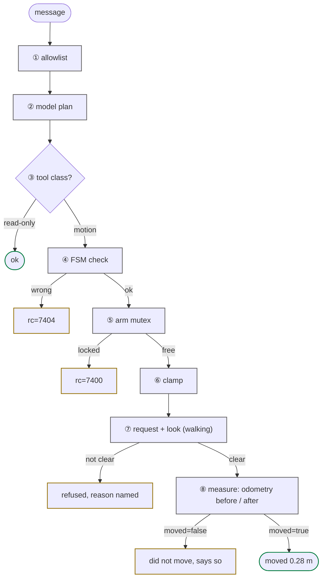

# safety model

<span class="read-badge">90s</span>

Eight gates between a user message and a motor torque. Any one refuses and the
motor stays idle; the eighth makes the robot tell the truth about what happened.



| # | gate | what it does |
|:-:|---|---|
| 1 | **allowlist** | Telegram IDs/usernames not in `TELEGRAM_ALLOWED_USERS` dropped before the model sees them |
| 2 | **model plan** | `prompts/base.md`: never walk uninvited or as a gesture, never `continuous=True`, never claim what the tool did not confirm |
| 3 | **tool class** | `G1_SAFE_TOOLS` omits walking; the slim voice/dashboard toolsets omit `use_unitree` and `g1_dds_publish`. Since ABXAGNTS-913 the *authorization* half of this gate lives in the credential plane (the mcp persona has no walk capability); `neon-mcp --safe` remains a prompt-availability control and the authz-off fallback |
| 4 | **FSM check** | motion needs `{500,501,801}` (arm) / `{501,801}` (walk); else `rc=7404`/`7302` |
| 5 | **arm mutex** | `rt/armsdk` single-writer lock; foreign writer → `rc=7400` |
| 6 | **clamp** | duration 0 to 10 s, distance 0.1 to 1.0 m per request, speed 0.05 to 0.5 m/s, yaw rate 0.1 to 0.6 rad/s ([table](../tools/composed.md)) |
| 7 | **request + look** | an explicit request to walk or turn is the consent, nothing else is; the agent looks first with `take_photo`, walks only in FSM 501, and a refusal names the reason |
| 8 | **honesty** | the walking tools read `rt/odommodestate` before and after and return `moved=true` with the metres or `moved=false`; "done" is allowed only on `moved=true` |

These eight gates are physical, identity, prompt and UX controls. They are
**not replaced** by the authorization layer below — the layer composes with
them (gate 1 decides *who*, the credential decides *what that persona may
make the robot do*).

## authorization layer (Agents++)

A policy layer between tool selection and execution (ABXAGNTS-911/912/913):
each persona holds an Agents++ verifiable credential whose capabilities match
its toolset — full local personas (shell, telegram, thinker) carry all of
them, slim voice/dashboard carry walk+stop+arm, and the remote **mcp**
persona carries stop+arm+dds but **no walk** (a remote client cannot walk the
robot, credential-level, with or without `--safe`). Every robot mutation
resolves to a capability; reads stay unmapped.

- **Enforced set** (synchronous gate, fail closed on deny *or* an
  unavailable Agents++ instance): `robot.motion.walk` (incl.
  `g1_set_task_id` and every walking SDK RPC), `robot.control.fsm.change`,
  `robot.control.zerotorque`, `robot.dds.publish.raw`.
- **Shadow** (audited, never blocking): arms and the generic
  `robot.control.sdk.rpc` hammer fallback.
- **`robot.motion.stop` is granted to every persona and never enforced** —
  the credential plane cannot disable the emergency stop.

`NEON_AUTHZ_MODE=off` (the default) makes the whole layer a zero-overhead
no-op; the eight gates above are unaffected either way. Operational details:
[authz runbook](authz-runbook.md).

## unsafe publishes

A raw publish to the five motor, BMS and hand topics needs `unsafe=True`
(`g1_dds_publish(topic="rt/lowcmd", payload={...}, unsafe=True)`); the flag
forces intent. Details on [use_dds](../tools/use-dds.md).

## emergency stop, always safe

```python
g1_stop_move()     # vx=vy=vyaw=0, any FSM
use_unitree("loco", "SetFsmId", {"fsm_id": 1})   # Damp, soft-hold current pose
# Ctrl-C in REPL   # drops agent, motors stay put
```

!!! danger "Never FSM 0 (ZeroTorque)"
    Drops all torque and the robot collapses. Only safe on a gantry. There is
    no dedicated tool for it; `use_unitree("loco", ...)` can still reach it,
    which is why `use_unitree` flags `ZeroTorque`, `SetFsmId`, `SetVelocity`,
    `Move`, `WaveHand`, `ShakeHand` and `ReleaseMode` as high danger in its
    reply (the warning fires always — the `BYPASS_TOOL_CONSENT` env-var
    bypass was removed in ABXAGNTS-914) and why the authz layer maps the op
    to `robot.control.zerotorque` (enforced, audited).

## audit trail

Every tool call from every persona is wrapped by `tools/tool_log.py`: one line
on stderr (`journalctl -u neon-voice -f`, `docker compose logs -f`) and one
`tool` row in `agent_log` (`.memory/mem.db`) with tool, status, `rc`, duration,
arguments and, for walks, `moved` and `measured_m`. Every authorization probe
adds an `authz` row with the resolved capability, ALLOW/DENY, the Agents++
`decision_id` and whether the call was gated (`enforced=true`) — and the
decisions persist server-side (`GET /authorization/decisions`). The dashboard
activity log shows the same rows: a spoken "done" can be checked against
them.

```bash
make log-show                 # last 30 turns across personas
journalctl -u neon-voice -f | grep -E 'tool='
```


---

[FSM + errors](../reference/fsm.md){ .md-button } [architecture](architecture.md){ .md-button }
